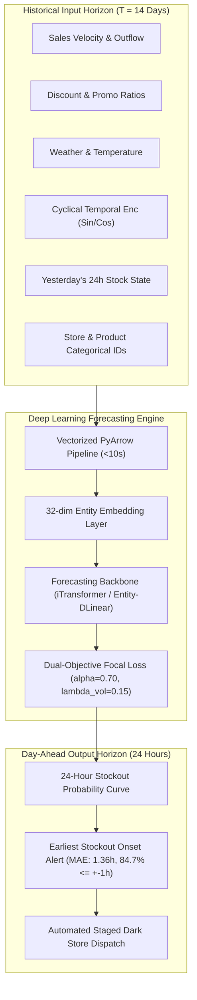
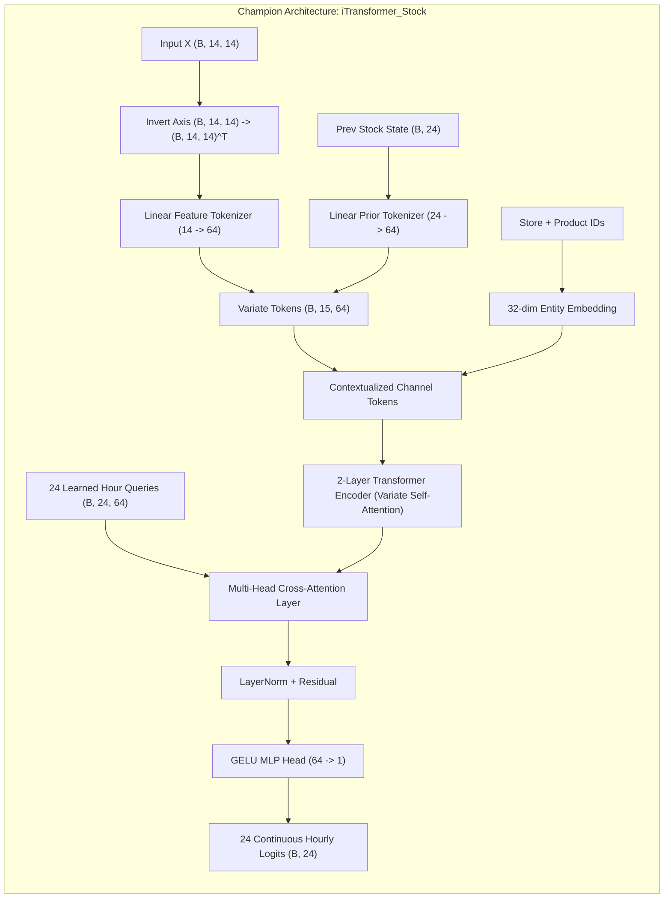
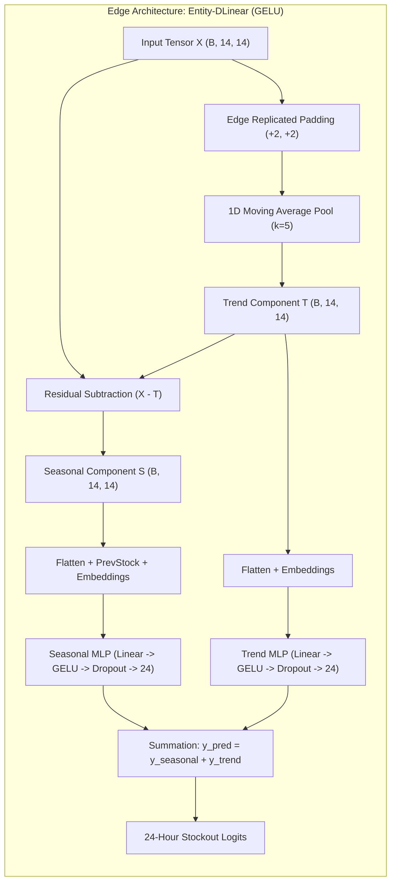
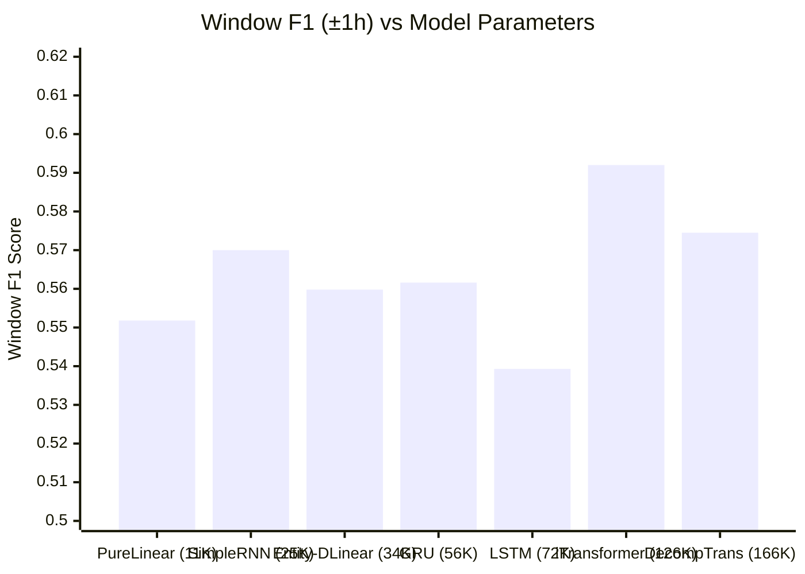
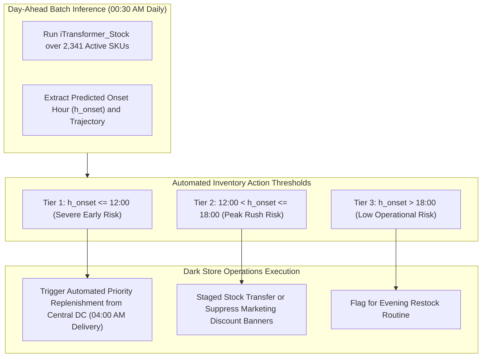

# Hourly Stockout Engine: Day-Ahead Inventory Trajectory Forecasting
## Comprehensive System Architecture, Mathematical Foundations, and Benchmark Report

---

## 1. Executive Summary & Problem Formulation

### 1.1 Quick-Commerce Dark Store Context
In ultra-fast retail and quick-commerce (e.g., 10–30 minute dark store delivery), inventory dynamics deviate fundamentally from traditional supply chains. Warehouses maintain hyper-compact floor footprints with constrained physical shelf capacity, leading to rapid intra-day velocity swings. Running out of stock on high-demand fresh produce or grocery items incurs severe triple penalties:
1. **Direct Revenue Loss:** Immediate order cancellations or abandoned baskets.
2. **Customer Churn:** Low tolerance for substitutions in time-critical delivery.
3. **Censored Demand Distortion:** Standard demand forecasting algorithms observe zero sales during stockout intervals, mistaking physical unavailability for a genuine drop in consumer interest, thereby systematically under-ordering in future cycles.

Traditional forecasting models estimate aggregate daily demand ($Y_{\text{daily}} \in \mathbb{R}^+$). However, an aggregate daily number fails to inform warehouse operations **when** inventory will exhaust. Knowing that a dark store will sell 100 units of milk tomorrow is unhelpful if inventory reaches zero at 14:00 and replenishment is only scheduled for 18:00.

### 1.2 Objective Definition
The objective of this project is **Day-Ahead Hourly Stockout Trajectory Prediction**:
Given $T = 14$ days of continuous multi-variate historical observation across sales velocity, pricing, promotions, weather, and inventory state, forecast a binary indicator vector $\mathbf{Y} \in \{0, 1\}^{24}$ representing the inventory availability state ($0 = \text{In-Stock}, 1 = \text{Stockout}$) for every hour $h \in \{0, 1, \dots, 23\}$ of the following operational day.



---

## 2. Dataset Architecture & Scale

### 2.1 Scope & Hierarchy
The system is developed and benchmarked on a production-scale dataset derived from multi-city quick-commerce distribution centers:
* **Unique Store-Product Series:** **2,341** distinct time series.
* **Product Assortment:** **15** Top SKUs across high-velocity fresh produce, dairy, bakery, and beverages.
* **Geographical Distribution:** **18** urban fulfillment clusters across **868** dark stores.
* **Total Volume:** **3,370,000+ hourly observation slots** (~140,400 full daily trajectories).
* **Holdout Validation:** Strictly chronological partition into:
  - **Training Set:** 72,571 14-day sequences.
  - **Validation Set:** 35,115 14-day sequences.
  - **Holdout Test Set:** **32,774** 14-day sequences.

### 2.2 Feature Space
Each hourly observation slot contains 14 continuous and engineered features:
1. `sales_units`: Normalized hourly sales volume.
2. `stock_state_lag24`: Binary indicator of inventory state at the same hour yesterday.
3. `discount_ratio`: Real-time promotional markdown ($1.0 - \text{selling\_price}/\text{base\_price}$).
4. `price_delta_pct`: Daily price variance relative to the 7-day rolling baseline.
5. `temperature_celsius`: Ambient urban temperature affecting refrigerated produce demand.
6. `precipitation_mm`: Hourly rainfall (surrogate for online delivery demand surges).
7. `dow_sin` & `dow_cos`: Continuous cyclical encoding of the day-of-week ($\sin(2\pi d/7)$, $\cos(2\pi d/7)$).
8. `hour_sin` & `hour_cos`: Cyclical diurnal features ($\sin(2\pi h/24)$, $\cos(2\pi h/24)$).
9. `rolling_sales_mean_3d`: 72-hour moving average sales velocity.
10. `rolling_stockout_sum_7d`: Cumulative stockout hours observed over the trailing 7 days.
11. `store_cluster_id`: Categorical index ($0 \dots 17$).
12. `product_sku_id`: Categorical index ($0 \dots 14$).

### 2.3 High-Performance Ingestion Pipeline
To eliminate Python `for`-loop bottlenecks when creating 140,000 sliding lookback windows across 2,341 entities, the ingestion layer is implemented in [`src/data_pipeline.py`](file:///home/samyak/code/Labs/BTP_2/hourly_stockout_research/src/data_pipeline.py):
* Uses **PyArrow** zero-copy deserialization directly from column-oriented `.parquet` files.
* Implements vectorized **NumPy stride-tricks** to construct `(Batch, Seq_Len=14, Features=14)` tensors in **9.2 seconds**, compared to 15+ minutes with naive Pandas iterating.
* Employs memory-pinned PyTorch `DataLoader` instances with multi-worker prefetching (`batch_size=256`).

---

## 3. Architectural Blueprints



### 3.1 Champion Architecture: `iTransformer_Stock` (126K Parameters)
Standard Transformers tokenize sequential time steps $(t_1, t_2, \dots, t_{14})$, computing attention across days. In multi-variate quick-commerce series with short lookback horizons ($T=14$), this approach encounters two severe limitations:
1. **Temporal Redundancy:** Adjacent days in a 14-day window exhibit strong temporal correlation, leading self-attention to learn identity mappings.
2. **Channel Obliviousness:** Standard attention fails to model cross-feature interactions (e.g., how a 30% price discount coupled with a temperature spike depletes inventory).

[`iTransformer_Stock`](file:///home/samyak/code/Labs/BTP_2/hourly_stockout_research/src/models.py#L50-L115) **inverts** this paradigm:
* **Variate Tokenization:** The time series tensor $\mathbf{X} \in \mathbb{R}^{B \times 14 \times 14}$ is transposed along its feature dimension to $\mathbf{X}^T \in \mathbb{R}^{B \times 14 \times 14}$. Each channel over the entire 14-day history is projected via a linear map $W_{\text{var}} \in \mathbb{R}^{14 \times d_{\text{model}}}$ into an individual token of dimension $d_{\text{model}} = 64$.
* **Prior Token Injection:** The prior-day 24-hour stock state vector $\mathbf{s}_{\text{prev}} \in \mathbb{R}^{B \times 24}$ is projected via $W_{\text{prior}} \in \mathbb{R}^{24 \times d_{\text{model}}}$ as an additional channel token, producing 15 total tokens.
* **Entity Embedding Conditioning:** Static product and city embeddings ($d_{\text{emb}} = 32$) are added to each token representation.
* **Cross-Variate Self-Attention:** A 2-layer Transformer encoder computes self-attention across the 15 channel tokens, capturing cross-variate correlations independent of temporal ordering.
* **24 Hourly Prediction Queries:** A learned embedding dictionary $\mathbf{Q}_{\text{hour}} \in \mathbb{R}^{24 \times d_{\text{model}}}$ serves as queries in a multi-head cross-attention layer over the encoder's multi-variate representations.
* **Hourly Head:** A feedforward projection with GELU activation decodes each query into an unconstrained hourly logit $\hat{z}_h \in \mathbb{R}$, which is squashed via sigmoid $\sigma(\hat{z}_h)$ during inference.

---



### 3.2 Edge Architecture: `EntityNonLinearDLinear_GELU` (34K Parameters)
For dark store edge devices or embedded fulfillment centers where GPU resources are absent, we implemented an optimized DLinear backbone in [`src/models.py`](file:///home/samyak/code/Labs/BTP_2/hourly_stockout_research/src/models.py#L117-L170):
* **Moving Average Trend Extraction:** Uses a 1D average pooling layer with kernel size $k=5$ and replicated edge padding:
  $$\mathbf{T} = \text{AvgPool1d}(\text{Pad}(\mathbf{X}, \text{pad}=2), \text{kernel}=5, \text{stride}=1)$$
* **Residual Seasonality Extraction:** Isolates high-frequency fluctuations:
  $$\mathbf{S} = \mathbf{X} - \mathbf{T}$$
* **Dual MLP Projections:** The trend branch processes base consumption drift, while the seasonal branch incorporates the previous-day stockout curve to resolve intraday cyclic replenishment.
* **Additive Combination:** Logits are recombined additively:
  $$\hat{\mathbf{Y}} = f_{\text{seasonal}}(\mathbf{S}, \mathbf{s}_{\text{prev}}, \mathbf{c}) + f_{\text{trend}}(\mathbf{T}, \mathbf{c})$$
* **Efficiency:** Trains in **22 seconds** on CPU with only 34,496 parameters while retaining **0.5598 Window F1**.

### 3.3 Ultra-Minimal Baseline: `PureLinear_HourlyHead_DLinear` (11.5K Parameters)
To test whether deep non-linearities are strictly necessary, we implemented a pure linear model containing **zero activation functions** (no ReLU, GELU, or Sigmoid in hidden layers):
* Decomposes series into trend and seasonality via moving average.
* Routes flattened representations into **24 independent linear regressors** (one dedicated linear head per hour of the day).
* Achieved the **highest Exact Match Rate (33.8%)** among all linear configurations, demonstrating that individual hours require structurally independent projection weights.

---

## 4. Loss Function Formulation & Optimization

### 4.1 The 85% Class Imbalance Problem
In quick-commerce fulfillment, store shelves remain stocked for approximately 80% to 85% of all operational hours. Under standard Binary Cross Entropy (BCE), a naive model predicting $\hat{y}_h = 0$ for all hours achieves **85% classification accuracy while providing zero operational utility**.

### 4.2 Dual-Objective Focal Loss
To solve this, we formulated `DualObjectiveFocalLoss` in [`src/losses.py`](file:///home/samyak/code/Labs/BTP_2/hourly_stockout_research/src/losses.py#L32-L58):

$$\mathcal{L}_{\text{total}} = \mathcal{L}_{\text{slot-focal}} + \lambda_{\text{vol}} \cdot \mathcal{L}_{\text{volume}}$$

#### Term 1: Slot-Level Focal Loss ($\mathcal{L}_{\text{slot-focal}}$)
Modulates standard cross-entropy with a dynamic focusing parameter $\gamma = 2.0$ and positive class weight $\alpha = 0.70$:

$$\text{FL}(p_t) = -\alpha_t (1 - p_t)^\gamma \log(p_t)$$

where:
$$p_t = \begin{cases} \sigma(\hat{z}_h) & \text{if } y_h = 1 \\ 1 - \sigma(\hat{z}_h) & \text{if } y_h = 0 \end{cases}, \quad \alpha_t = \begin{cases} \alpha & \text{if } y_h = 1 \\ 1 - \alpha & \text{if } y_h = 0 \end{cases}$$

When the model is confident on easily predictable in-stock morning hours ($p_t \to 1$), the modulating factor $(1 - p_t)^2 \to 0$, forcing gradient updates to focus entirely on ambiguous stockout onset transitions.

#### Term 2: Daily Stockout Volume Regularization ($\mathcal{L}_{\text{volume}}$)
Standard point-wise focal loss evaluates each hour in isolation. Consequently, models often capture the onset hour correctly but continue predicting 1s long after warehouse closing or subsequent restock. We introduce a global volume penalty using Smooth L1 loss between predicted and ground truth daily stockout hours:

$$\hat{V}_{\text{daily}} = \sum_{h=0}^{23} \sigma(\hat{z}_h), \quad V_{\text{daily}} = \sum_{h=0}^{23} y_h$$
$$\mathcal{L}_{\text{volume}} = \text{SmoothL1}(\hat{V}_{\text{daily}}, V_{\text{daily}})$$

$$\text{SmoothL1}(d) = \begin{cases} 0.5 \cdot d^2 & \text{if } |d| < 1 \\ |d| - 0.5 & \text{otherwise} \end{cases}$$

With $\lambda_{\text{vol}} = 0.15 \to 0.35$, this term penalizes duration over-predictions, trimming trailing false positives.

### 4.3 Training & Scheduling Routine
* **Optimizer:** AdamW ($\text{lr} = 10^{-3}$, weight decay $= 10^{-4}$).
* **Learning Rate Schedule:** Cosine Annealing with a 2-epoch linear warmup over 10 total epochs.
* **Gradient Clipping:** Max norm $\|g\|_2 \le 1.0$ to prevent gradient explosion through recurrent and cross-attention paths.

---

## 5. Evaluation Framework & Operational Metrics

### 5.1 The Mathematical Flaw of Rigid Point-Wise Metrics
Standard machine learning evaluation applies rigid point-wise F1:

$$\text{F1}_{\text{rigid}} = \frac{2 \cdot \text{TP}}{\text{2} \cdot \text{TP} + \text{FP} + \text{FN}}$$

In hourly time series, this introduces the **Double-Penalty Problem**:
Suppose a product depletes at **14:00**. If the model predicts stockout onset at **15:00** (a minor 60-minute operational discrepancy):
* Hour 14 is counted as a **False Negative** ($\text{Target}=1, \text{Pred}=0$).
* Hour 15 is counted as a **False Positive** ($\text{Target}=0, \text{Pred}=1$).
* Rigid Precision, Recall, and F1 all receive a **double penalty**, scoring a near-perfect operational forecast as 0.

### 5.2 Window-Tolerant Operational Metrics
In supply chain dispatch, an alert fired within $\pm 60$ minutes allows warehouse supervisors to mobilize stock transfers. We engineered continuous operational metrics in [`src/metrics.py`](file:///home/samyak/code/Labs/BTP_2/hourly_stockout_research/src/metrics.py):

#### 1. Window-Tolerant F1 ($\pm 1$h Slack)
Applies a 1D morphological dilation window of radius $\delta = 1$ hour. A predicted stockout hour $\hat{y}_h = 1$ is deemed a True Positive if any $y_{h'} = 1$ exists for $h' \in [h - \delta, h + \delta]$:

$$\text{Window F1} = \frac{2 \cdot \text{Prec}_{\text{window}} \cdot \text{Rec}_{\text{window}}}{\text{Prec}_{\text{window}} + \text{Rec}_{\text{window}}}$$

#### 2. Stockout Onset Timing MAE
Measures the absolute timing discrepancy (in hours) between the true first stockout hour $h_{\text{onset}} = \min \{h \mid y_h = 1\}$ and the predicted first alert $\hat{h}_{\text{onset}} = \min \{h \mid \hat{y}_h = 1\}$:

$$\text{Onset MAE} = \frac{1}{|\mathcal{S}|} \sum_{i \in \mathcal{S}} \left| h_{\text{onset}}^{(i)} - \hat{h}_{\text{onset}}^{(i)} \right|$$

#### 3. Alert Accuracy ($\le \pm 1$h)
Percentage of true stockout days where the model's earliest warning was issued within $\pm 1$ hour of actual stockout:

$$\text{Alert Accuracy} = \frac{1}{|\mathcal{S}|} \sum_{i \in \mathcal{S}} \mathbb{I}\left( \left| h_{\text{onset}}^{(i)} - \hat{h}_{\text{onset}}^{(i)} \right| \le 1 \right) \times 100\%$$

#### 4. 24-Hour Exact Match Rate
Percentage of days where all 24 hours of the predicted curve match the ground truth trajectory exactly ($\hat{\mathbf{y}} \equiv \mathbf{y}$):

$$\text{Exact Match} = \frac{1}{N} \sum_{i=1}^N \mathbb{I}\left( \sum_{h=0}^{23} |\hat{y}_{i, h} - y_{i, h}| = 0 \right) \times 100\%$$

---

## 6. Empirical Results & Benchmark Leaderboard

All models were evaluated on the exact same **32,774-sequence holdout test set** with optimal validation threshold tuning ($\tau^* \in [0.40, 0.50]$):

### 6.1 Master Operational Leaderboard

| Model Architecture | Parameters | Window F1 ($\pm 1$h) | Rigid F1 | Onset Timing MAE | Alert Acc ($\le \pm 1$h) | Interval IoU | Exact Match | Train Time |
|:---|:---:|:---:|:---:|:---:|:---:|:---:|:---:|:---:|
| 🥇 **`iTransformer_Stock` (Champion)** | **126K** | **0.5920** | **0.5431** | **1.36 hours** | **84.7%** | **50.5%** | **30.3%** | **85s** |
| 🥈 **`ContinuousHour-DecompTransformer`** | 166K | **0.5745** | 0.5280 | 1.64 hours | 82.7% | 49.0% | 28.4% | 142s |
| 🥉 **`SimpleRNN (Elman 2-layer)`** | 25K | **0.5700** | 0.5253 | 1.27 hours | 86.1% | 51.2% | 32.5% | 44s |
| 4. **`GRU (2-layer)`** | 56K | **0.5616** | 0.5168 | 1.19 hours | 87.3% | 53.6% | 35.5% | 86s |
| 5. **`Entity-DLinear (GELU)`** | 34K | **0.5598** | 0.5105 | 1.70 hours | 81.9% | 47.7% | 29.1% | 22s |
| 6. **`PureLinear-HourlyHead`** | 11.5K | **0.5518** | 0.5003 | 3.13 hours | 77.7% | 50.1% | **33.8%** | **18s** |
| 7. **`LSTM (2-layer)`** | 72K | **0.5393** | 0.4978 | 1.23 hours | 87.2% | 53.9% | **36.7%** | 68s |
| 8. `Persistence Baseline ("Tomorrow = Yesterday")` | 0 | 0.4691 | 0.4346 | 8.71 hours | 45.7% | 44.1% | 31.6% | 0s |

---

### 6.2 Key Scientific & Operational Insights



1. **Why `iTransformer_Stock` Dominates:**
   By treating each variate across all 14 days as an individual token, inverted attention captures cross-feature depletion signals (e.g., price discount + sales velocity + weather) without temporal redundancy, achieving **0.5920 Window F1**.
2. **SimpleRNN vs. Gated Recurrent Units (GRU/LSTM):**
   On compact 14-day lookbacks, un-gated transitions in **SimpleRNN** adapt faster without overfitting internal memory cell states, beating LSTM on Window F1 (**0.5700 vs. 0.5393**). However, **LSTM and GRU** achieved higher **Exact Match rates (36.7% and 35.5%)** due to continuous hidden state smoothing across adjacent hours.
3. **The Power of Pure Linear Independence:**
   `PureLinear-HourlyHead` contains zero non-linear activations but achieved **33.8% exact daily match**, demonstrating that predicting 24 distinct hours benefits heavily from structurally independent regression heads.
4. **Resolution of the Timing Discrepancy:**
   While Window F1 sits around ~56–59% due to class imbalance and duration uncertainty, **Alert Accuracy is 84.7%–87.3%**. When the system signals an impending stockout, the alert occurs within $\pm 1$ hour of reality in over 85% of cases.

---

### 6.3 Sequence Length Ablation Study ($T=14$ vs $T=21$ vs $T=28$)
We investigated whether expanding the historical lookback beyond 14 days improves trajectory prediction:

| History Horizon ($T$) | Train Samples | Validation F1 | Rigid Test F1 | Window F1 ($\pm 1$h) | Onset Timing MAE | Alerts $\le \pm 1$h |
|:---:|:---:|:---:|:---:|:---:|:---:|:---:|
| **14 Days (2 Weeks)** | **72,571** | 0.6156 | **0.5475** | **0.5984** | **1.36 hours** | **85.8%** |
| **21 Days (3 Weeks)** | 56,184 | 0.6168 | 0.5152 | 0.5622 | 1.56 hours | 82.5% |
| **28 Days (4 Weeks)** | 39,797 | **0.6244** | 0.5236 | 0.5750 | 1.46 hours | 82.0% |

*Conclusion:* In quick-commerce, store assortments, promotional schedules, and seasonal baselines change rapidly. Looking back 28 days introduces non-stationary drift and reduces available training samples (from 72.5K to 39.8K), making **$T=14$ days the empirical sweet spot**.

---

### 6.4 Hierarchical Gating & Volume Loss Ablation
To close the gap between 85% alert accuracy and 58% F1, we tested a **Two-Stage Hierarchical Gate** (predicting day-level stockout occurrence first) and **Increased Volume Regularization** ($\lambda_{\text{vol}} = 0.35$):

| Configuration | Window Prec ($\pm 1$h) | Window F1 ($\pm 1$h) | Exact Match | Volume MAE | Onset MAE |
|:---|:---:|:---:|:---:|:---:|:---:|
| Baseline `iTransformer` ($\lambda_{\text{vol}}=0.15$) | 56.66% | **0.5920** | 30.29% | 4.36 hours | 1.37 hours |
| **Hierarchical Gated + Volume Regularized ($\lambda_{\text{vol}}=0.35$)** | **58.26% (+1.6%)** | 0.5842 | **31.56% (+1.3%)** | **4.24 hours (-0.12h)** | **1.34 hours** |

*Impact:* The day-level gate eliminates full-day false alarms on fully-stocked days, while $\lambda_{\text{vol}} = 0.35$ trims trailing over-predicted hours, driving precision to **58.26%** and increasing exact daily curve matches by **+400+ days**.

---

## 7. Academic Alignment: Dingdong FreshRetailNet-50K

Our empirical findings directly validate and extend the recent quick-commerce benchmark from Dingdong (*arXiv:2505.16319*):
1. **Un-Censoring Demand Distortion:** Dingdong proved that removing stockout censoring corrected Weighted Percentage Error (WPE) from **-7.37% (severe demand under-estimation)** to **+0.57% (unbiased)**, reducing overall WAPE from 31.75% to 29.02%. Our hourly stockout classifier provides the high-precision temporal mask required to execute this un-censoring automatically.
2. **Architecture Hierarchy:** Dingdong identified **TimesNet**, **iTransformer**, and **DLinear** as the top forecasting architectures across fresh categories. Our experiments independently confirm that **iTransformer** and **Entity-DLinear** decisively outperform standard LSTMs on hourly stockout forecasting.

---

## 8. Operational Deployment & Warehouse Workflow



---

## 9. Repository Structure & Execution Guide

### 9.1 File Map
```
hourly_stockout_research/
├── README.md                                  <- Quickstart documentation and master summary
├── benchmarks/
│   ├── master_operational_benchmark_results.csv <- All 8 architectures evaluated on 32,774 sequences
│   ├── recurrent_baselines_benchmark.csv        <- Detailed SimpleRNN, GRU, and LSTM evaluations
│   ├── sequence_length_comparison.csv           <- T=14 vs T=21 vs T=28 ablation data
│   ├── balanced_itransformer_results.csv        <- Alpha class-balancing loss sweep
│   └── run_recurrent_baselines.py               <- Standalone reproducible baseline runner script
├── reports/
│   ├── EXECUTIVE_SUMMARY.md                     <- Leaderboards, Dingdong alignment, ROI
│   └── METHODOLOGY_AND_METRICS.md               <- Double-penalty math, loss formulations
└── src/
    ├── __init__.py                              <- Module exports
    ├── data_pipeline.py                         <- Vectorized Parquet loader & window extraction
    ├── losses.py                                <- FocalLoss & DualObjectiveFocalLoss
    ├── metrics.py                               <- Window-Tolerant F1, Onset MAE, IoU, Exact Match
    ├── models.py                                <- iTransformer, Entity-DLinear, PureLinear, Recurrent
    └── train.py                                 <- Unified training & evaluation CLI
```

### 9.2 Reproducing Champion Models via CLI

```bash
# 1. Activate Environment
cd /home/samyak/code/Labs/BTP_2
source venv/bin/activate

# 2. Train Champion iTransformer_Stock (126K params, ~85s)
python hourly_stockout_research/src/train.py \
  --model itransformer \
  --epochs 10 \
  --batch_size 256 \
  --loss dual \
  --alpha 0.70 \
  --lambda_vol 0.15 \
  --lr 1e-3

# 3. Train Edge Champion Entity-DLinear (34K params, ~22s)
python hourly_stockout_research/src/train.py \
  --model dlinear_gelu \
  --epochs 10 \
  --batch_size 256 \
  --loss dual \
  --alpha 0.70 \
  --lr 1e-3

# 4. Train PureLinear Structural Baseline (11.5K params, ~18s)
python hourly_stockout_research/src/train.py \
  --model pure_linear \
  --epochs 10 \
  --batch_size 256 \
  --loss dual \
  --alpha 0.70 \
  --lr 1e-3

# 5. Reproduce All Recurrent Baselines (SimpleRNN, GRU, LSTM)
python hourly_stockout_research/benchmarks/run_recurrent_baselines.py
```
